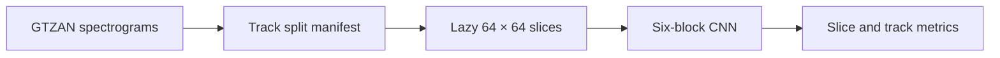

# Music Genre Classification with CNNs

**Audio classification · PyTorch · Experiment design · Reproducible evaluation**

A ten-class music genre classifier that learns from mel-spectrogram images, developed for the University of Toronto's APS360 course in **January–April 2024**. This personal portfolio repository recreates the classifier in a **2026 implementation** with a command-line pipeline, source-track-disjoint splits, checkpoint provenance, and automated tests.

The central question: **how well can a CNN distinguish musical genres from short visual representations of audio, and how should that performance be measured?**

## At a glance

- **Modeling:** six convolutional blocks, dropout, a dense classifier, SGD, and a Random Forest feature baseline.
- **Data engineering:** lazy spectrogram slicing, a fixed ten-class mapping, deterministic track manifests, and source-file hashes.
- **Evaluation:** slice and track metrics from the same inference pass, macro-F1, confusion matrices, and validation-based checkpoint selection.
- **Engineering:** installable Python package, CLI, unit tests, synthetic end-to-end verification, and GitHub Actions configuration.

**Status:** the refactored pipeline is tested on synthetic fixtures. No new GTZAN benchmark, trained weights, or music recordings are bundled. Historical scores below belong to the original notebook, not the refactor.

## Historical experiment

| Model / dataset | Recorded accuracy | Interpretation |
| --- | ---: | --- |
| CNN / GTZAN validation | 65.95% | Original slice-level split |
| CNN / GTZAN test | 69.35% | Original slice-level split |
| Random Forest / validation | 79.38% | Numeric segments; a different split protocol |
| CNN / external music | 65.35% | Stored historical result; assets and label mapping unavailable |

**Evaluation limitation:** the original CNN split slices after slicing each source image, allowing pieces of one track into multiple partitions. These figures do **not** establish performance on unseen tracks. The refactor splits source tracks first. The baseline and historical CNN scores are not a controlled head-to-head comparison. See the [evaluation audit](docs/evaluation.md) for evidence and corrections.

## Pipeline



Each source image yields 32 RGB slices. The selected historical architecture uses channel widths **12 → 24 → 48 → 96 → 192 → 384**, followed by dense layers **512 → 128 → 64 → 10**. The refactor keeps this topology while correcting the evaluation protocol.

## Run locally

Python 3.11 or newer. Run these commands from the repository root:

```bash
python -m venv .venv
source .venv/bin/activate
# Windows PowerShell: .venv\Scripts\Activate.ps1
python -m pip install -e .
python -m unittest discover -s tests -v
python scripts/smoke_test.py
```

The smoke test needs no dataset and makes no claim about classification quality.

Download the dataset separately and follow [data setup](docs/data.md). Then:

```bash
music-genre prepare --images data/gtzan/images_original --out data/splits.json
music-genre train --images data/gtzan/images_original --manifest data/splits.json --config configs/model_set13.json --out runs/cnn
music-genre evaluate --images data/gtzan/images_original --manifest data/splits.json --checkpoint runs/cnn/best.pt --out runs/cnn/test.json
music-genre baseline --csv data/gtzan/features_3_sec.csv --manifest data/splits.json --out runs/baseline.json
music-genre predict --image data/gtzan/images_original/blues/blues00000.png --checkpoint runs/cnn/best.pt
```

Use `--device cuda` on train, evaluate, and predict for a compatible GPU installation. The selected configuration runs for 100 epochs; `--epochs 1` is useful for checking your setup, not reporting model quality. Evaluate the test split only after fixing model and preprocessing choices.

Optional local-audio conversion:

```bash
python -m pip install -e '.[audio]'
music-genre spectrogram --audio /path/to/your/audio.wav --out data/example.png --offset 0 --duration 30
music-genre predict --image data/example.png --checkpoint runs/cnn/best.pt
```

Audio must contain the full requested interval. New audio rendering can differ from GTZAN image rendering, so this is an inference utility, not a validated deployment demo. Softmax scores are not calibrated confidence estimates.

## Explore the project

| File / directory | Purpose |
| --- | --- |
| [Project walkthrough](notebooks/02_project_walkthrough.ipynb) | Guided introduction to data, architecture, and evaluation |
| [Archived experiment](notebooks/01_original_experiment.ipynb) | Original code cells with outputs and metadata removed |
| [Evaluation audit](docs/evaluation.md) | Historical evidence, limitations, and refactor decisions |
| [Model card](docs/model-card.md) | Intended use, architecture, limitations, and reproducibility |
| [Historical results](results/historical/metrics.json) | Recorded values and source-file fingerprints |
| `src/music_genre/` | Data, model, training, evaluation, baseline, and CLI |
| `tests/` and `scripts/smoke_test.py` | Correctness checks and executable integration test |
